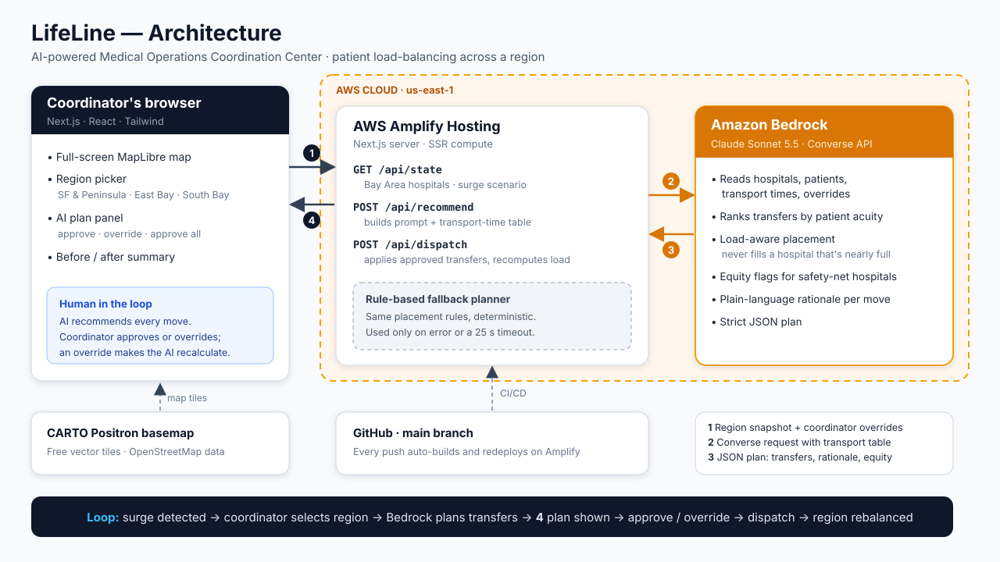

# LifeLine — AI-Powered Medical Operations Coordination Center

> When a surge overwhelms some hospitals while others nearby still have beds, LifeLine gives a regional coordinator the real-time picture and the AI-reasoned transfer plan to rebalance patients before anyone is left to collapse.

Built for the **AI-Driven Automation & Critical Service Continuity** challenge, powered by **Amazon Bedrock** on AWS.

---

## The Persona & The Need

**Dr. Okonkwo — Regional Medical Operations Coordinator.**

Dr. Okonkwo sits above eight hospitals in her region. Her job is the one that only exists in a crisis: keep any single hospital from collapsing when demand spikes. When a mass-casualty event or an infectious surge hits, patients don't spread evenly — one hospital goes to 150% capacity with patients in hallways, while another 20 minutes away has open ICU beds.

In that moment she has to answer, under extreme pressure:

1. **Which hospitals are critically overloaded right now, and which still have room?**
2. **Which specific patients should move, in what order, to which receiving hospital?**
3. **Is the receiving hospital actually capable** of the patient's needs (ICU level, ventilator, cardiac, pediatric)?
4. **Who is being harmed by the imbalance** — are under-resourced hospitals absorbing a disproportionate share?

Today this is done by phone, fax, and spreadsheet. It is too slow, blind to the full real-time picture, and the people doing it are overwhelmed.

### Why this is real

This exact failure is documented by the US government and peer-reviewed research:

- **Patient load-balancing** — redistributing patients away from overwhelmed facilities to ones with capacity — "likely saves lives," per HHS lessons learned during COVID-19 ([HHS ASPR TRACIE](https://files.asprtracie.hhs.gov/documents/mocc-patient-load-balancing-summary-of-lessons-learned-during-covid-19.pdf)). *Content rephrased for compliance.*
- COVID-19 surges were geographically uneven: some systems were slammed while others nearby had excess capacity ([CDC](https://stacks.cdc.gov/view/cdc/91351/cdc_91351_DS1.pdf)). *Content rephrased for compliance.*
- The imbalance was an **equity failure**: hospitals serving more Black and Medicaid patients were significantly more likely to be overloaded while other area hospitals had room ([Weill Cornell Medicine](https://research.weill.cornell.edu/about-us/news-updates/patient-transfer-systems-needed-ensure-equity-icus-overload-during-pandemic)). *Content rephrased for compliance.*
- Where no coordinating system existed, allocation decisions defaulted to individual clinicians under extreme pressure ([*Intensive Care Medicine*, 2026](https://pubmed.ncbi.nlm.nih.gov/42272205/)). *Content rephrased for compliance.*

The government's response was the **Medical Operations Coordination Center (MOCC)** — but it was run by hand. LifeLine is the intelligence that the MOCC never had.

---

## What We Built

LifeLine is a continuity system that detects a regional imbalance and acts to reduce harm. It is the "air traffic control" for patients across a region — a live picture of every hospital plus an AI that reasons out exactly how to rebalance the load.

When a surge hits, LifeLine:

1. **Detects the imbalance** — reads live hospital status and identifies critically overloaded facilities vs. those with spare capacity.
2. **Recommends transfers** — reasons over patient acuity, receiving-hospital capability, and transport distance to propose specific patient moves, each with a plain-language justification.
3. **Flags equity + keeps a human in control** — surfaces when under-resourced hospitals are absorbing a disproportionate share, and recalculates in real time when the coordinator overrides a recommendation.

The coordinator goes from a blizzard of phone calls to an executable, defensible rebalancing plan in seconds.

### Core user flow

```
A surge overloads 3 of 8 hospitals; others still have capacity
        │
        ▼
Coordinator clicks "Rebalance with AI"
        │
        ▼
[Bedrock]  Detect   →  which facilities are critical, which have room
        │
        ▼
[Bedrock]  Recommend →  ranked patient transfers + rationale per move
        │
        ▼
[Bedrock]  Equity    →  flags disproportionate overload on vulnerable sites
        │
        ▼
Coordinator reviews, overrides where needed (AI recalculates), dispatches
```

---

## How Amazon Bedrock Powers the AI

Bedrock is the reasoning engine at the center of LifeLine — the brain the MOCC never had. It is integral, not bolted on.

| Capability | What Bedrock does | Why it matters |
|---|---|---|
| **Load-aware placement** | Matches each patient to a capable hospital, spreading load so no receiving hospital is pushed to full while others nearby have room. | Prevents the rebalance from creating a new overloaded hospital. |
| **Transfer recommendation** | Reasons over patient acuity + receiving-hospital capability + transport feasibility to produce a ranked list of specific patient moves, each with a human-readable rationale. | The coordinator can trust, defend, and act on the plan. Explainability is a safety requirement in crisis triage. |
| **Equity reasoning** | Detects when under-resourced facilities are absorbing a disproportionate share of the overload and prioritizes decompressing them. | Directly addresses the documented equity failure of ad-hoc COVID rationing. |
| **Live recalculation** | When the coordinator overrides a transfer, re-reasons the downstream effect on remaining placements. | Keeps a human in the loop — the research shows pure algorithmic rationing fails. |

> Model: Claude Sonnet 5.5 on Amazon Bedrock (`us.anthropic.claude-sonnet-5-5`, cross-region inference profile), called through the Bedrock Runtime `Converse` API from the Next.js server. Bedrock receives a precomputed transport-time table so it reasons about placement, not geometry.

---

## Architecture



**Flow:**
1. The coordinator selects a region. The browser sends that region's hospitals, patients and any overrides to `POST /api/recommend`.
2. The Next.js server on AWS Amplify builds the prompt plus a precomputed transport-time table and calls Claude Sonnet 5.5 through the Bedrock Converse API.
3. Bedrock returns a strict-JSON plan: ranked transfers, a rationale for each, and equity flags.
4. The coordinator approves or overrides each move (an override triggers a recalculation), then dispatches via `POST /api/dispatch`.

If Bedrock errors or takes longer than 25 seconds, a deterministic rule-based planner with the same rules produces the plan instead, and the UI labels it as the fallback.

> **What is real vs. simulated:** Hospital capacity data is simulated (seeded, toggleable) because live multi-hospital feeds are the hard real-world integration, not buildable in the hackathon window. The **Bedrock reasoning is fully real** — it reads the actual patient and capacity state and produces the transfer plan, justifications, and equity flags. That reasoning is the core of the product.

---

## Tech Stack

| Layer | Technology |
|---|---|
| AI / reasoning | **Amazon Bedrock** (Claude Sonnet 5.5, Converse API) |
| Hosting / CI/CD | **AWS Amplify Hosting** (Next.js SSR, auto-deploy from GitHub `main`) |
| App + API | **Next.js** (App Router, API routes) |
| UI | React, Tailwind CSS |
| Map | MapLibre GL + CARTO Positron basemap (OpenStreetMap data) |
| Data | Seeded JSON + in-memory store |
| Dev tooling | Built with **Kiro** |

---

## Project Status

- [x] Next.js + Tailwind app, deployed on AWS Amplify (auto-deploy from `main`)
- [x] Bay Area seed data: 3 coordination regions, 19 hospitals, surge scenario
- [x] Bedrock (Claude Sonnet 5.5) transfer planning with rationale and equity flags
- [x] Load-aware placement, with a rule-based fallback that follows the same rules
- [x] Full-screen MapLibre map, region selection, animated transfer arcs
- [x] Approve / override (AI recalculates) / approve all / dispatch, with before/after summary
- [ ] Clinical handoff note per transfer (stretch, not built)
- [ ] Live hospital capacity feeds (real-world integration, out of scope)

---

## Running Locally

> **Prerequisites:** Node.js 20+, an AWS account with **Amazon Bedrock model access** enabled for the chosen Claude model, and AWS credentials configured locally.

```bash
# 1. Install dependencies
npm install

# 2. Configure environment (optional: without credentials the app
#    runs on the rule-based fallback planner)
cp .env.example .env.local
#   set BEDROCK_REGION, BEDROCK_MODEL_ID, and AWS credentials

# 3. Run the app (also copies MapLibre's web worker into public/)
npm run dev
#   open http://localhost:3000
```

On Windows PowerShell, use `npm.cmd` instead of `npm`.

### Environment variables

| Variable | Description |
|---|---|
| `BEDROCK_REGION` | Region for Bedrock (default `us-east-1`) |
| `BEDROCK_MODEL_ID` | Default `us.anthropic.claude-sonnet-5-5`; must be enabled in your account |
| `AWS_ACCESS_KEY_ID` / `AWS_SECRET_ACCESS_KEY` / `AWS_SESSION_TOKEN` | AWS credentials (or `AWS_PROFILE`) |

Hosting on AWS Amplify: see [SETUP.md](SETUP.md#7-deploying-to-aws-amplify).


---

## Team & Contact

- **Team:** Group 29
- **Track:** AWS — AI-Driven Automation & Critical Service Continuity
- **Contact:** _add your team's contact channel here before submission_

---

## Acknowledgements

Problem framing informed by US government (HHS ASPR, CDC) and peer-reviewed research on patient load-balancing and Medical Operations Coordination Centers during COVID-19. Content from these sources was rephrased and summarized for compliance with licensing restrictions; see linked sources above.
